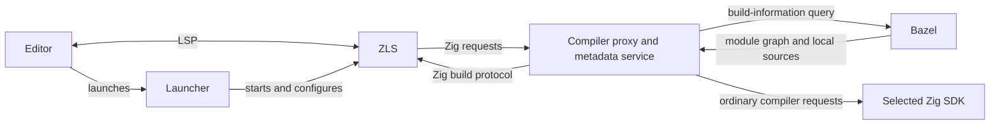

# ZLS with Bazel

ZLS needs a project's module roots, named imports and source locations to
understand code. Bazel already knows that graph. This integration presents the
selected Bazel graph through the build protocol that ZLS 0.17 expects, while
keeping application builds under Bazel's control.

## Flow

## Responsibilities

- **Launcher and toolchains:** select compatible Zig and ZLS tools for the
  editor's host and start the session. The launcher target must match the editor
  host even when source-producing actions run remotely.
- **Bazel:** determines the module graph for the targets selected by
  `zls_completion`, including import names and generated inputs. Source
  producers run as needed, and their outputs are made available locally for
  ZLS to read. Application outputs are not requested for this metadata query.
- **Compiler proxy and metadata service:** route ZLS's build-information
  requests to Bazel and return the graph through the selected SDK's native
  build protocol. Ordinary compiler requests go to the real Zig SDK. Requests
  to execute application build steps or enable build-on-save fail explicitly.
- **ZLS:** uses that graph to resolve imports and provide diagnostics,
  completion and navigation over LSP. It handles editor document updates;
  Bazel remains responsible for building the application.

## Discovery, refresh and lifetime

An existing `build.zig` in the source ancestry is ZLS's discovery marker. Its
build logic is not executed by this integration; the selected Bazel targets
define the graph.

Each ZLS configuration reload queries Bazel again, so changed build metadata
and generated sources become visible. Saving the discovery marker can trigger
that reload. BUILD and MODULE files are not watched automatically; source-text
updates continue through normal LSP document synchronization.

The launcher supervises the ZLS session and its owned helpers. Cancellation or
shutdown stops owned queries and removes temporary session files, without
treating shared Bazel servers or unrelated processes as session-owned.

The 0.17 route currently supports Linux/macOS and one selected Bazel
configuration. ZLS's existing external-document association and conflicting
module-context limitations still apply. ZLS 0.16 retains its separate custom
build-runner route.

See the [setup instructions](../../README.md#zls) for toolchain registration
and editor configuration.
