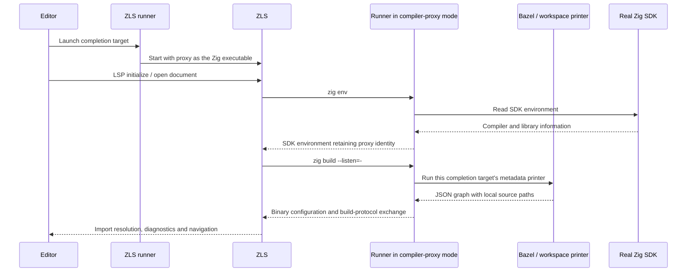

# How the ZLS integration works

ZLS 0.17 discovers a project's modules by asking a Zig executable for build
information through Zig's binary build protocol. Our launcher also acts as that
Zig executable: it answers build-information requests using the selected Bazel
targets, and forwards ordinary compiler requests to the real Zig SDK.

There are two conversations: the editor speaks LSP with ZLS, while ZLS speaks
Zig's build protocol with our adapter. The JSON produced by the workspace
printer is an intermediate format; it is not sent directly to ZLS.

## A session from launch to navigation

The outer runner supervises ZLS. ZLS starts a fresh instance of the same
executable for each Zig command; the proxy lifeline groups those invocations.
The existing `build.zig` in a document's ancestry is ZLS's discovery marker.
Its build logic is bypassed by the proxy.

## Preparing the graph: completion target and exporter

[`zls_completion.bzl`](zls_completion.bzl) connects a chosen set of targets to
a launcher and a metadata-printer target. The launcher is therefore bound to
that selection, rather than discovering arbitrary Bazel targets at runtime.

[`zls_write_build_config.bzl`](zls_write_build_config.bzl) exports the selected
roots, their transitive modules and named import edges as JSON. It also includes
the source inputs needed to read that graph, so generated sources are produced
and available locally when the printer runs. The exported paths still contain
workspace and execution-root placeholders at this stage.

## Starting ZLS and intercepting Zig requests: the runner

[`zls_runner_017.zig`](zls_runner_017.zig) starts ZLS with a temporary
configuration that points its Zig executable back at the runner itself. It
retains the real SDK path for forwarding compiler requests.

The proxy handles three cases:

- **`zig env`:** obtain the real SDK's environment, but report the proxy as
  `zig_exe`. ZLS uses that field for later requests; returning the real compiler
  here would cause its build-information requests to bypass the integration.
- **`zig build --listen=-`:** enter the metadata service described below.
- **Other non-build compiler requests:** invoke the real SDK and preserve its
  output and exit status. This includes the compiler queries ZLS uses alongside
  build metadata. Unsupported `zig build` invocations are rejected.

[`zls_runner_common.zig`](zls_runner_common.zig) provides the shared launch
preparation: runtime-file lookup, temporary configuration, arguments and
environment. The version-specific runners control the session and protocol.

## Resolving the graph's paths: the workspace printer

Each metadata load runs `bazel run` on the completion target's
`.print_build_config` target, whose executable is
[`workspace_printer.zig`](workspace_printer.zig).

That invocation regenerates the JSON graph as needed and materializes its
source inputs. The printer then replaces workspace/output placeholders and
canonicalizes module paths and import destinations. Its output is JSON whose
paths refer to the actual local files ZLS will open, including external and
generated files.

The execution-root identity comes from the configuration artifact being read.
This keeps the graph tied to the Bazel invocation that produced it, including
when a different output base is used. Canonical paths also let ZLS associate a
file opened by the editor with the same file referenced by an import.

## Speaking ZLS's build protocol: the BSP service

[`zls_bsp.zig`](zls_bsp.zig) consumes the printer's JSON and turns it into the
configuration ZLS expects. Here BSP refers to **Zig's binary build protocol**,
not JSON-RPC.

It constructs a `std.Build` module graph with the exported imports and
compilation roots, then uses the selected SDK's serializer to write a binary
configuration file. Synthetic compilation roots make library-only selections
visible to ZLS; they are metadata and are never executed.

The service performs the handshake, sends ZLS the configuration file's path, and
answers ZLS's empty build round with completion. It then remains available for
protocol messages until ZLS ends the protocol session or closes the connection.
The configuration file stays alive for that exchange.

This is a finite metadata service. Requests to execute build steps or watch
for build-on-save fail explicitly. A failed Bazel query or invalid graph is
reported to ZLS as a configuration failure.

## Cancellation and cleanup: the process owner

[`owned_process.zig`](owned_process.zig) supervises the child processes used
by the outer runner, compiler proxy and metadata service. Each child starts in
a dedicated process group. Cleanup also reaches helpers remaining in that
group after the child exits.

While a Bazel query is running, the service still observes cancellation,
connection closure and ZLS's exit request. The process owner stops the owned
group, escalates termination if needed, and waits for the child to be reaped.
The surrounding runner/service then removes its temporary configuration files.
The outer runner gives inner helpers time to perform this cleanup when the
whole ZLS session ends. Shared Bazel daemons are outside this ownership.

## Reloads and version boundary

Every new metadata load repeats the printer query and configuration exchange.
A ZLS configuration reload, such as saving its discovery marker, can therefore
pick up changed BUILD/MODULE metadata and generated sources. Those Bazel files
are not watched automatically. Ordinary document edits continue through LSP.

The 0.16 path remains separate: [`zls_runner.zig`](zls_runner.zig) configures
ZLS's custom build runner, which obtains JSON from the same workspace printer.
The 0.17 path adds the compiler proxy and binary-protocol conversion described
above.

The current 0.17 route supports Linux/macOS and one selected configuration.
Existing ZLS limitations around external-document association and conflicting
module contexts still apply. See the [setup instructions](../../README.md#zls)
for editor configuration.
